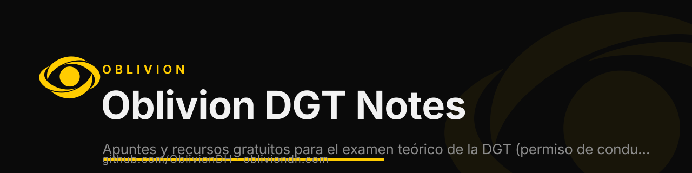

  

<h1 align="center">Oblivion DGT Notes</h1>

  
  
  
  

<b>Apuntes y recursos gratuitos para el examen teórico de la DGT (permiso de conducir, España): temas, definiciones y actividades. By Oblivion.</b>

`dgt` · `carnet-de-conducir` · `examen-teorico` · `spain` · `driving-test` · `study-notes`

---

¡Bienvenido, novato mandril de la carretera! Has encontrado el grimorio definitivo para dominar el arte de circular, aprobar exámenes y, de paso, reírte más que en la autoescuela con el pelado de turno, que ya esta cansado de decir la misma clase desde que empezó a ser alumno en ella. Aquí cada sección viene con un input de información y un toque de humor. ¡No te duermas o te comerás esa señal de STOP!

## 🧩 Temas Principales
- [Tema 1: Conceptos Básicos de Tráfico](temas/tema_1.md) 🧠
    - [Permisos de Conducción](temas_teoricos/permisos_conduccion.md) 🎫
    - [Tipos de Vías](temas_apoyo/tipos_de_vias.md) 🛣️
- [Tema 2: Permisos, Documentos y Puntos](temas/tema_2.md) 🎫
- [Tema 3: Obligaciones y usuarios de la vía](temas/tema_3.md) 🚸
- [Tema 4: El Gran Baile de la Circulación](temas/tema_4.md) 💃
- [Tema 5: ¡Matrículas y Misterios!](temas/tema_5.md) 🔍
- [Tema 6: ¡Conduce y Cuida el Planeta!](temas/tema_6.md) 🌱
- [Tema 7: ¡Preparando el Viaje!](temas/tema_7.md) 🧳
    - [Normas de Circulación](temas_teoricos/normas_circulacion.md) 🚦
    - [Señales de Tráfico](temas_teoricos/senales.md) 🛑
    - [Seguridad Vial](temas_teoricos/seguridad_vial.md) 🦺

## 🚗 Definiciones Importantes
- [Definiciones de Vehículos](definiciones/vehiculos.md) 🚗
- [Ciclos y Vehículos Eléctricos](definiciones/ciclos.md) ⚡
- [Señales de Tráfico](definiciones/senales.md) 🚥
- [Prioridad de Paso](definiciones/prioridad.md) 🏁
- [Seguridad Vial](definiciones/seguridad.md) 🦺
- [Definiciones Complementarias](definiciones/complementarias.md) 🧙‍♀️

## 📑 Anexos y Secretos
- [LegenCode de Abreviaturas](legends/legencode.md) 🧾

## 📝 Notas y Actividades
- [Actividades: Desafía tu sabiduría vial](actividades/activityindex.md) 🎲
- [Notas rápidas (para despistados y genios olvidadizos)](notas/noteindex.md) 📝

---

## 😒 Info Extra
- Todos los archivos tienen un link de regreso a casita, si aqui: ¡haz clic en “Volver al índice” y aparecerás aquí como por arte de derrape!
- Si te pierdes, invoca a tu profe, a tu compi o a tu sentido común. (O simplemente vuelve aquí, que es más fácil).
- ¿Quieres más info? ¡Sugiere tu propia opinion o sección y la añadimos si nos interesa!

---

¿Listo para convertirte en el Vin Diesel de la circulación? ¡Explora, aprende y que la DGT no te pille desprevenido! 🚦

## ⚠️ Ethical use

Oblivion DGT Notes is built for **authorized security testing, education and CTFs only**. Use it only on systems you own or have explicit written permission to test. You are responsible for complying with all applicable laws. The authors accept no liability for misuse.

## About Oblivion

Built by [**Oblivion**](https://obliviondh.com) — cybersecurity, cloud and AI. This tool is part of the Oblivion open-source toolkit.

- 🌐 Website: [obliviondh.com](https://obliviondh.com)
- 🎓 Learn: [Oblivion Academy](https://academy.obliviondh.com)
- 💬 Community: [Discord](https://discord.gg/f4mZBU9xS8)
- 🔗 All links: [linktr.ee/ivanbg2004](https://linktr.ee/ivanbg2004)
- 👤 Author: [Ivan Barnola Gasch](https://www.linkedin.com/in/ivanbg2004/)

Keywords: dgt, carnet-de-conducir, examen-teorico, spain, driving-test, study-notes, apuntes, free-resources.

© 2026 Oblivion. If this project helped you, leave a ⭐ — it helps others find it.

